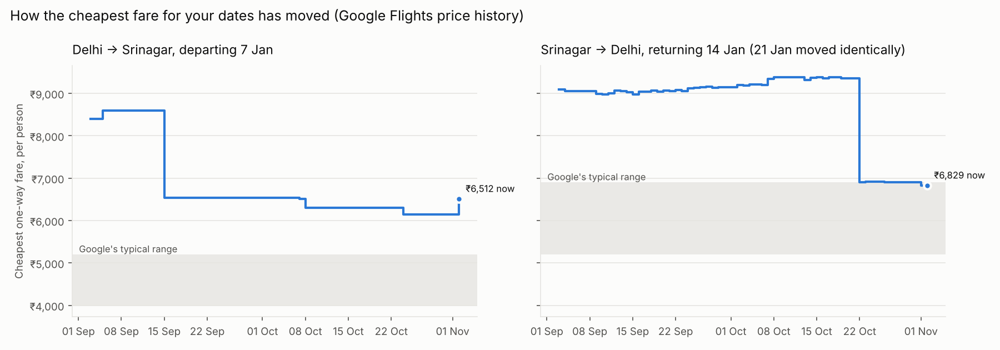

# Fare status, 01 Nov 2026

Trip: DEL→SXR on 2027-01-07, return SXR→DEL on 2027-01-14 or 2027-01-21, 2 adults.

| Leg | Travel date | Days out | Cheapest now (per person) | Google typical | Lowest seen in last 60 days | Signal |
|---|---|---|---|---|---|---|
| DEL→SXR | 2027-01-07 | 67 | ₹6,512 | ₹4,000–5,200 | ₹6,147 | WAIT (book by 08 Dec at the latest) |
| SXR→DEL | 2027-01-14 | 74 | ₹6,829 | ₹5,200–6,900 | ₹6,829 | **BUY** (at/below typical or target) |
| SXR→DEL | 2027-01-21 | 81 | ₹6,829 | ₹5,200–6,900 | ₹6,829 | **BUY** (at/below typical or target) |

Latest safe booking point from the booking curve: **30 days before departure** (default; not enough curve data yet).

